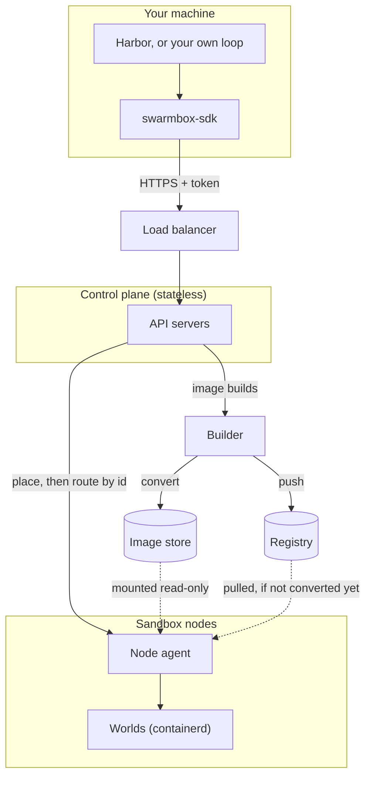
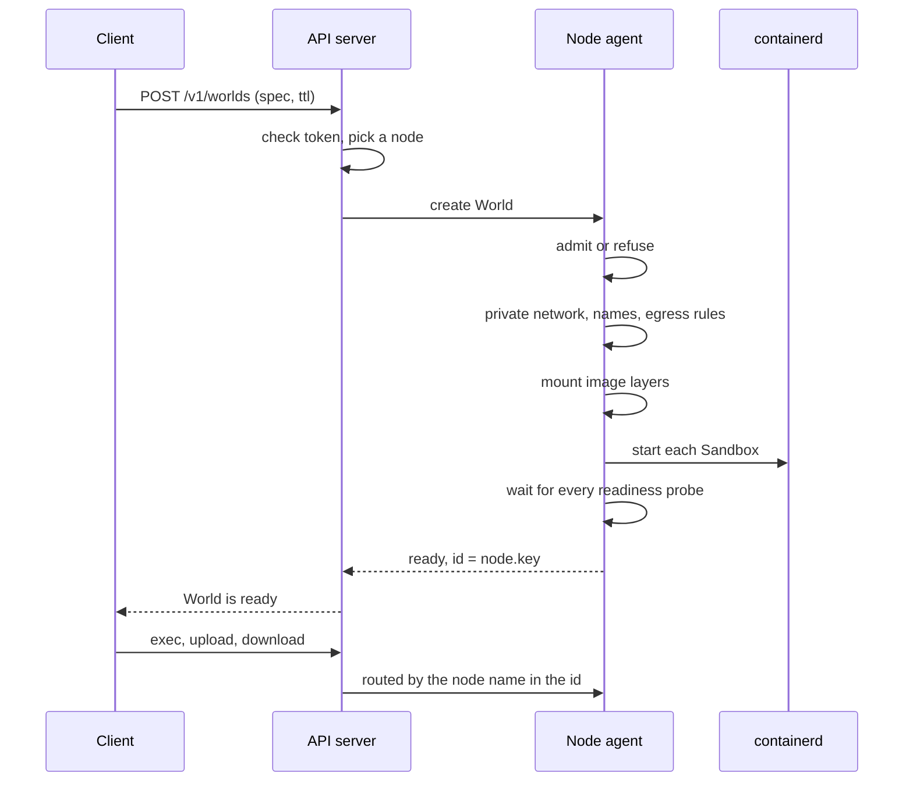
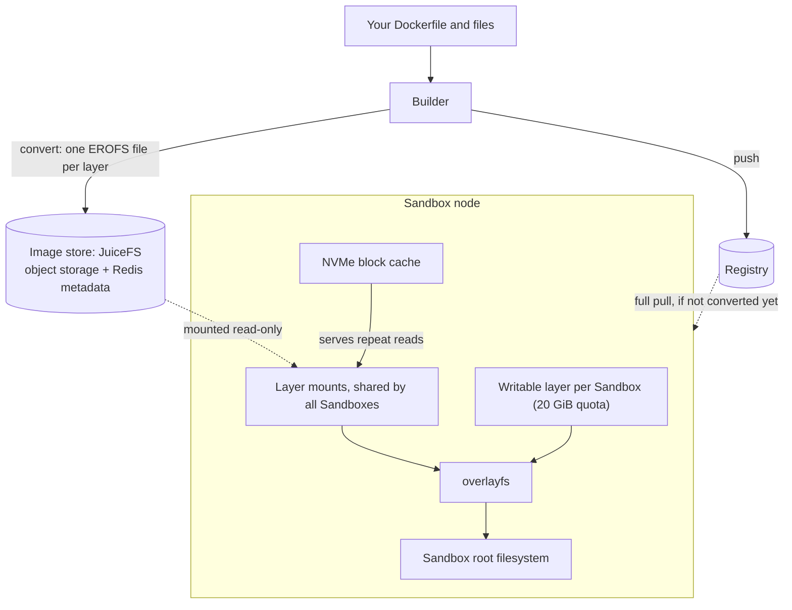

# Architecture

The parts of swarmbox, what each one does, and why it is built this way. swarmbox is modelled on [DeepSeek Elastic Compute (DSec)](https://arxiv.org/abs/2609.22978), DeepSeek's system for running RL rollouts at large scale, and runs on ordinary cloud VMs.

- **API servers** check your token, pick a node and forward the request. They hold no state, so several run behind a load balancer and one can be lost.
- **Node agents**, one per Sandbox node, own their [Worlds](worlds-and-sandboxes.md) end to end: networking, containers, readiness, time limits and cleanup.
- **The builder** turns your Dockerfile into an image and pushes it to the registry.
- **The image store** holds built images as layers every node can mount. An image not yet converted into it is pulled from the registry.

## What swarmbox took from DSec, and what it swapped

Three of DSec's ideas are kept:

1. **Placement is stateless and the node is the source of truth.** There is no central database of Sandboxes to fall behind when thousands start and stop.
2. **Images load lazily.** Layers are stored as EROFS files (a read-only filesystem format the Linux kernel mounts directly) on shared storage, and a node fetches only the blocks a task reads. The paper reports tasks reading 4% to 13% of their images.
3. **The client is a small async library**, so one rollout loop can hold hundreds of Sandboxes open.

DSec's design leans on infrastructure its authors control: a storage layer built for RDMA networks, and a patched Docker daemon. swarmbox runs on rented cloud VMs, so those parts differ.

| DSec | swarmbox |
|---|---|
| 3FS over RDMA for image layers | [JuiceFS](https://juicefs.com): data in object storage, metadata in managed Redis, a block cache on each node's local NVMe |
| Patched dockerd | Stock containerd, driven directly by the node agent |
| Sandbox as the unit | World as the unit: Sandboxes with one network and one lifecycle |
| Function calls, containers, microVMs, full VMs | Containers only |

swarmbox runs on Azure. Nothing in the core is tied to it: the storage is an object store and a Redis.

## One request

A World's ID looks like `<node>.<key>`. To route a later request, an API server reads the ID. There is nothing to look up, so there is no database between you and your World, and adding another API server takes no coordination.

World state lives on the node. Each node agent writes a small record per World to its own disk. When a new agent is deployed it restarts, reads its records and picks its running Worlds back up, and the containers keep running throughout. So the platform is updated while trials are in flight.

swarmbox does not use Kubernetes. Its control plane is built to keep long-running services healthy, and this load is thousands of short-lived container groups an hour. Plain VMs, a stateless API layer and an agent per node fit that better. The cost is that per-World networking, DNS names, health checks and placement are swarmbox's to maintain.

## Lazy images

Starting a container normally means downloading the whole image, unpacking it, then running. For a 4 GB task image that is most of a minute, paid again on every node that hasn't seen it.

swarmbox converts each image layer once into an EROFS file in the shared store. A node mounts those files in milliseconds, puts a private writable layer on top and starts the container. A read fetches only the blocks it touches, and those blocks stay in a cache on the node's NVMe.

Time until the World is ready, one World per image:

| Image, unpacked | Pulled whole (node had never seen it) | Mounted lazily |
|---|---|---|
| 3.9 GB | 48.4 s | 0.5 s |
| 2.7 GB | 31.4 s | 0.6 s |
| 1.8 GB | 20.0 s | 0.1 s |

Lazy loading moves the cost to the first read. The worst first command measured (start Python, import 5 modules, list all of `/usr`) took about 10 seconds with an empty cache. So nodes warm their cache with the store's layers shortly after they start, and that command drops to about one second.

There is a fallback. If the image store is unhealthy, the node switches itself to full pulls and reports it. An image that hasn't been converted yet is also pulled whole. In both cases the World starts.

## Image builds

You upload a build context, and the builder builds the image, pushes it and converts it. Each User's builds run in their own BuildKit instance with its own cache, on a network that reaches the internet and nothing private. Images are tagged by a hash of the build context, so an unchanged task is a lookup. Each User has their own repository, so one User can't replace another's image. [Built images](world-spec.md#built-images) has the API and its limits.

## Admission and placement

A node refuses a new World when it is under pressure. It watches the kernel's CPU pressure figure (how long processes waited for a CPU) and keeps a memory reserve. It also caps the total CPU and memory that Worlds have declared, which catches a burst that arrives before pressure shows.

When a node refuses, the API server tries one other node. If that one refuses too, you get `503 no capacity`. The Harbor provider retries that for up to 5 minutes; the SDK on its own does not.

swarmbox refuses work because a slow node skews timing-sensitive evals, and a node that runs out of memory kills Sandboxes in Worlds that were otherwise fine.

## Isolation

Sandboxes run model-written commands and whatever packages a task pulls in. swarmbox treats that code as unvetted.

- The default runtime is runc with seccomp (a syscall filter), user namespaces (root in a Sandbox is not root on the node), a process limit and no new privileges.
- gVisor, a userspace kernel that sits between the container and the host, can be switched on per User with no change on their side.
- Each Sandbox's [egress](glossary.md#egress) is `none` or `public`. Sandboxes in a World always reach each other, Worlds never do, and outbound connections are capped.
- Each Sandbox's writable layer has a 20 GiB quota.
- A World belongs to the User who created it. Anyone else gets a `404`.

## Measured on the test bed

Two more measurements, taken in November 2026 through the test bed's public endpoint:

- **A full run.** 220 Harbor tasks from the public [validated-tasks](https://huggingface.co/datasets/FWeindel/validated-tasks) dataset, run with their reference solutions on two nodes, 32 at a time, with images already built: all finished in under 4 minutes with no infrastructure error.
- **Environment start.** The median Harbor environment start was 0.25 s.

## What it doesn't do yet

- **The first run of a large task set is slow.** Every new image has to be built, and builds queue.
- **A Sandbox sees the node's CPU count and memory, not its own limits.** The limits are enforced, but `nproc` is wrong, so tools that size themselves by CPU count start too many workers.
- **Built images are never cleaned up.**
- **Containers only.** They share the node's kernel unless a User is on gVisor. There are no microVMs, GPUs, pause and resume, or snapshots.
- **The platform itself is not open source today.** The SDK, the Harbor provider and these docs are.
