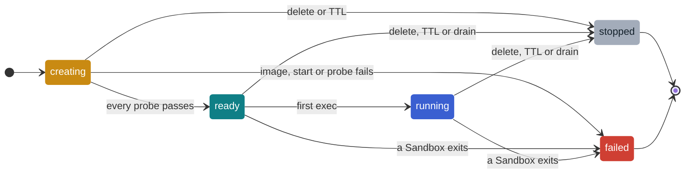

# Worlds and Sandboxes

An agentic RL task is rarely one container. An enterprise-ops task needs the agent's workspace plus a mock ServiceNow. A tool-use task needs an MCP server next to the agent. A software task needs a repository, sometimes with a database beside it. Each trial needs its own copy of that setup: fresh, isolated, and gone when the trial ends.

In swarmbox, each of those containers is a [Sandbox](glossary.md#sandbox), and the group of them for one trial is a [World](glossary.md#world). The [glossary](glossary.md) defines both. This page explains why they are shaped this way.

## Why a World, not loose Sandboxes

The obvious alternative is a platform that runs single Sandboxes and leaves the caller to wire them together, the way Harbor's `docker` environment assembles a compose project for each trial. Most sandbox services work this way. It holds up until something goes wrong halfway:

- **Orphans.** If the caller dies between `up` and `down`, nothing cleans up. At thousands of trials an hour, the leftovers add up.
- **Partial setups.** If a mock service crashes but the agent's Sandbox keeps running, the trial goes on against a setup that is half missing. It can still produce a score, just a wrong one.
- **Shared limits.** Every compose project takes a network from the host's pool. In our runs, Harbor's docker environment failed 9 to 11% of trials at 32 at a time because Docker ran out of address pools.

When the platform owns the whole group, those failures belong to the platform, and it can rule them out. A World is created in one call, comes up in one piece, and is torn down in one piece by whoever ends it: you, its TTL, or a failure. Its Sandboxes are fixed when it's created, so there is never a moment when half of it exists.

> **This model is provisional.** Running a trial's Sandboxes as one World is being tested against real workloads. The test looks at whether every task fits without special cases, how many tasks need a Sandbox to start or stop on its own, and whether any Sandbox outlives its World. If the group fails those measures, swarmbox falls back to Worlds of one Sandbox each, joined to a network the platform provides.

## One private network per World

Every Sandbox gets an address on a small subnet of its own World. The node agent writes `/etc/hosts` before any Sandbox starts, so every name resolves from the first instruction, and no Sandbox races another to register. Aliases let a task keep the hostnames it was written against: an agent can call `servicenow.example.internal` and reach the mock that answers to that name.

Worlds never see each other. Each Sandbox declares its own [egress](glossary.md#egress). The default, `none`, means only its own World, with no external DNS. `public` adds the internet, but never private ranges, cloud metadata or the node. Egress is per Sandbox, so a mock service can stay sealed off while the agent's workspace downloads packages. Today egress is all or nothing; per-host allowlists are planned.

## A World lives and dies as one

- **`creating`**: the node agent builds the network, pulls the images (in parallel, from its cache when it can), starts every Sandbox and runs their readiness probes. The create call doesn't return until this is over, so a caller never holds a half-built World.
- **`ready`**: every probe has passed.
- **`running`**: someone has run a command in it.
- **`stopped`**: it ended without a failure. You deleted it, its TTL ran out (either can happen while it is still `creating`), or its node was drained for maintenance. The World's `reason` says which: `stopped by user`, `ttl expired` or `node drained`.
- **`failed`**: the platform could not deliver the World. An image didn't pull, a probe never passed, or a Sandbox exited. One Sandbox dying fails the whole World, because a partial World is worse than none.

`failed` always means an infrastructure failure, never a task outcome. An agent that gets the task wrong leaves behind a World that stopped cleanly. The bad news is in the exit codes and files it produced, and those are for the verifier to judge.

Every World has a mandatory TTL of at most 24 hours. Nothing has to remember to clean up. If a client crashes, loses its network or forgets, the node agent reaps the World when its time runs out.

## Why the verifier gets a World of its own

A verifier often carries hidden tests. Inside the agent's World, the agent could read them or tamper with them. So when a task's verifier must not share the agent's World, it runs in a separate World. That World is created after the trial's World stops, and the agent's output is handed over as files. As a bonus, no Sandbox of a World ever needs to start later than the others. That keeps the model simple: the verifier is the one case where a lifecycle diverges, and it is handled by making it a different World.

## Execution signals, not rewards

The platform returns [execution signals](glossary.md#execution-signal) and never computes a reward. Scoring belongs to the Environment's verifier.

That line keeps swarmbox reusable. The same platform runs ITSMBench and the Marin project's software tasks today without knowing what "correct" means for either, and an Environment author changes scoring without touching the platform.

## Related decisions

- **A Sandbox is one container; the group is a World.** That is why the names are what they are.
- **The node agent drives containerd directly.** The cost accepted is that swarmbox owns each World's networking, as described above.
- **No Kubernetes.** World churn is exactly what saturates Kubernetes-style control planes.
